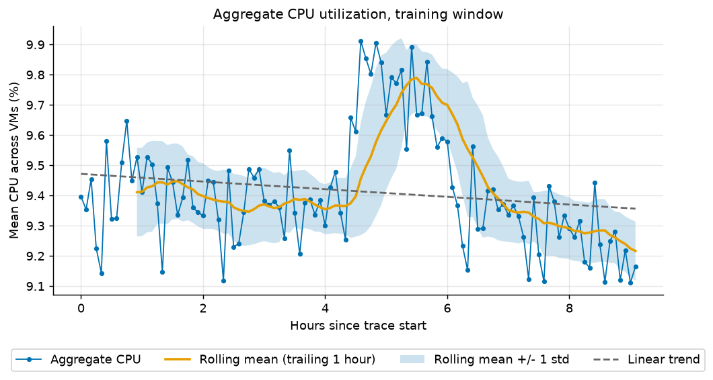
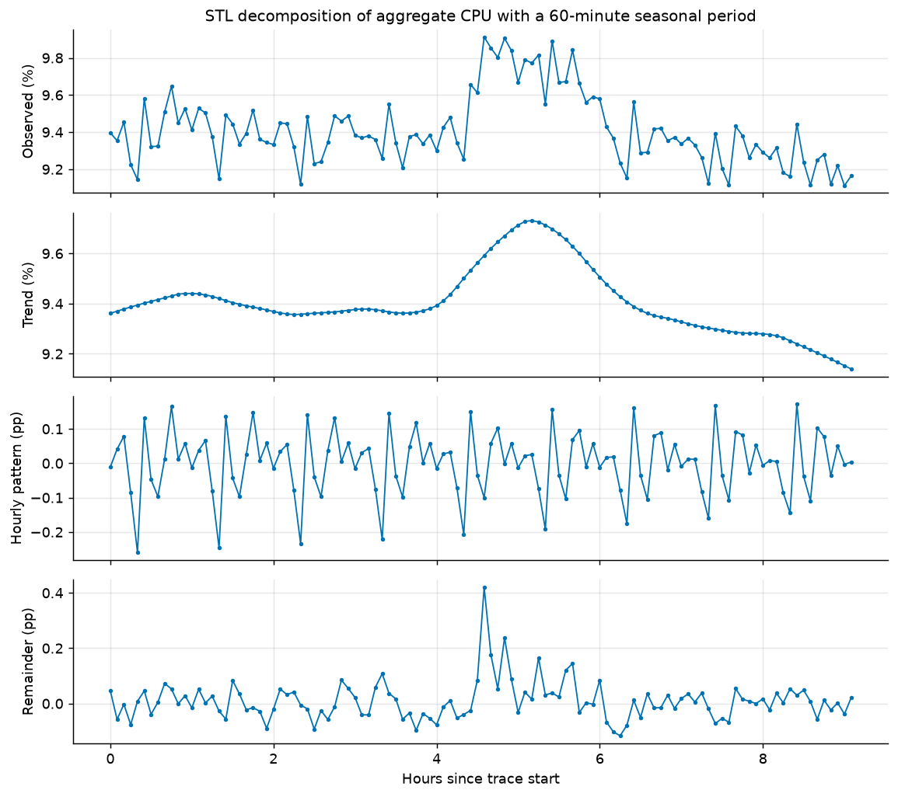
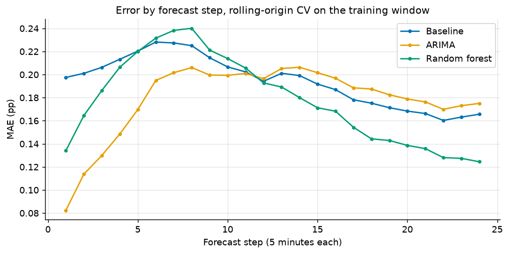
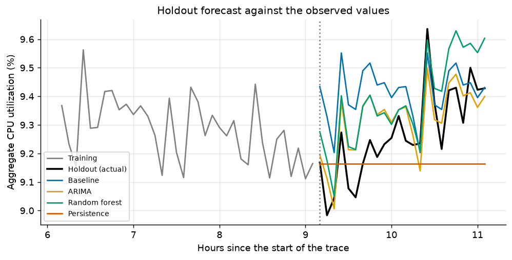
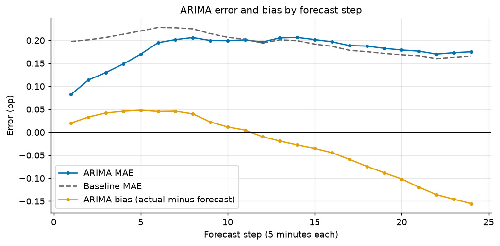
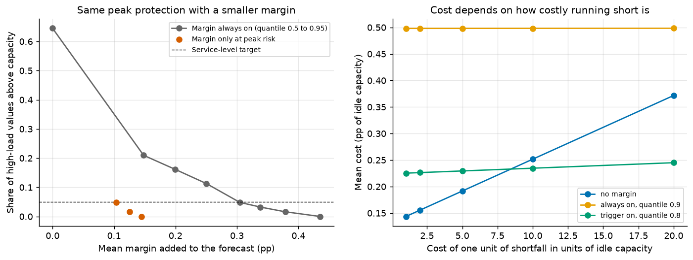
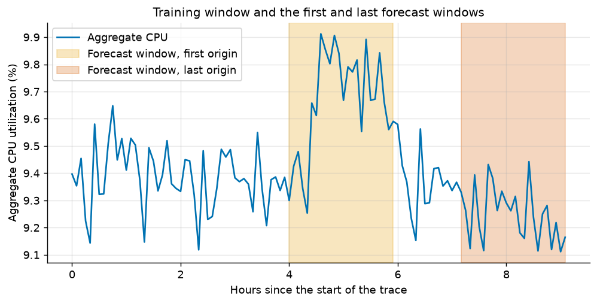
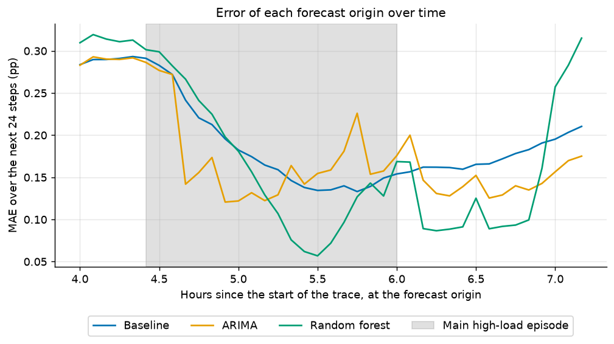
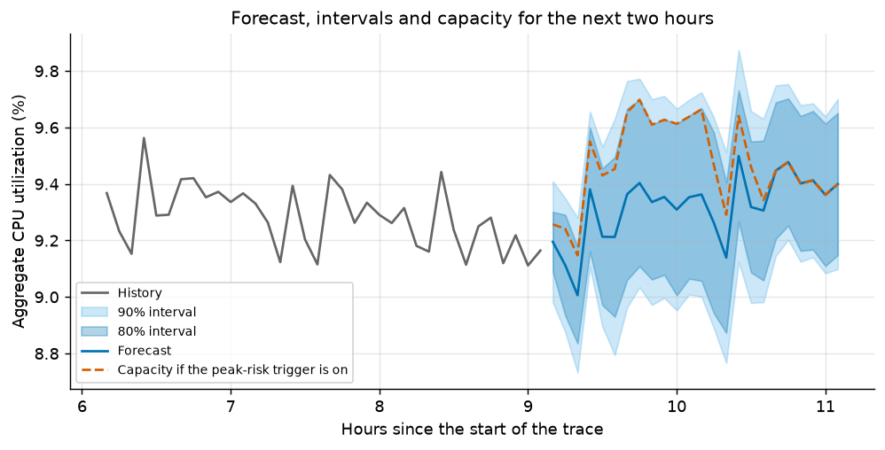
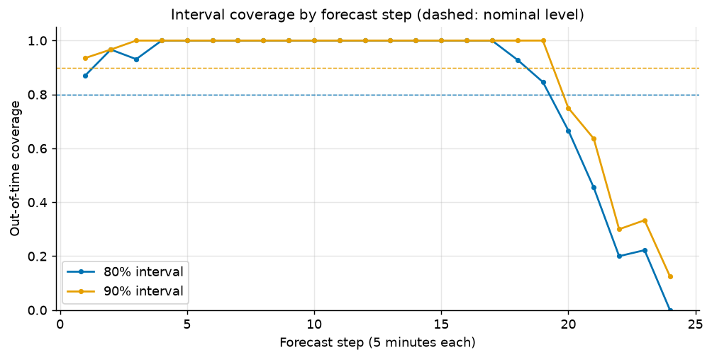

# Forecasting Azure VM workload: how predictable is it and what should a team do with the forecast

Cloud Workload Forecasting Challenge, Microsoft Azure Public Dataset V2 (`data-v1`). CPU values are percentages of one VM's capacity, "pp" means percentage points, one step is 5 minutes. Every number comes from `notebooks/`, `src/cwfc/` and the tables in `reports/tables/`.

## 1. Executive summary

**Question.** How predictable is this workload, how accurately can the next two hours be forecast, and what should an infrastructure team do with the forecast?

- **The VM count is not a forecasting problem.** `active_vm_count` is exactly 10,000 at all 110 training timestamps (the data-quality check shows the same at all 134), so repeating the last value is exact in every validation window and on the holdout.
- **The CPU level is stable but not flat.** `aggregate_cpu_utilization` has a mean of 9.41% and a standard deviation of 0.19 pp. It moves through a repeating one-hour pattern (a dip of about 0.2 pp at minute 20, seen in 9 of 9 hours) and one level shift (+0.39 pp for about 1.7 hours).
- **Forecasts help, modestly.** A strong baseline (training mean plus hourly profile) has a cross-validated MAE of 0.194 pp. The chosen model, ARIMA(1,0,0) with the hourly profile as an input, reaches 0.179 pp (8.1% lower), and 0.082 pp against 0.198 pp five minutes ahead. The gain is gone by about one hour ahead. A random forest reaches 0.177 pp, a tie.
- **Holdout** (scored once, after `predictions.csv` was written): ARIMA MAE 0.091 pp, RMSE 0.104 pp, 0.56 times the baseline's MAE (0.161 pp). One two-hour window cannot rank models, so it was reported and never used for a choice.
- **Advice.** All three models under-forecast peaks (by 0.22 to 0.30 pp at high-load values), and the start of a level shift cannot be forecast. Plan at the forecast, and add a margin from earlier errors only when the mean of the last three observations is at or above the 80th percentile of the history. In cross-validation this leaves 4.8% of high-load values above capacity with a mean margin of 0.10 pp, against 0.31 pp for an always-on margin with the same protection. The trigger is off now, so the plan for the next two hours is the forecast (9.20% to 9.40%).

**Caveat.** 110 training points are about 2.6 independent 24-step windows and one main episode. The fleet-level workload is predictable, and ARIMA with the hourly profile is a sound, simple choice, but its gain over the baseline (0.016 pp of MAE) is small next to the origin-to-origin spread of its error (standard deviation 0.058 pp) and rests on one episode.

## 2. Data understanding and preprocessing

**Data.** `vm_cpu_readings.csv.gz` has 1,340,000 rows: 10,000 VMs with 134 readings each on an exact 300-second grid. `vm_metadata.csv.gz` describes the same VMs. `01_eda.ipynb` found no duplicates, no missing ids or values, no out-of-range readings and exactly 10,000 reporting VMs at every timestamp.

**Targets** (`data.py`). Readings are grouped by timestamp. `active_vm_count` is the number of distinct VMs, so each counts once. `aggregate_cpu_utilization` is the mean `avg_cpu` over readings that are present and inside [0, 100]. In the training window, a timestamp with no valid reading, a gap or a duplicate is never filled in: the pipeline stops with a clear error. The modelling cadence is the native 5 minutes, so no mapping back is needed, and `predictions.csv` carries the raw holdout timestamps.

**Split.** The full target series is built first. The last 24 timestamps (2 hours) are the holdout and the 110 before them (9.2 hours) the training window; the 24 is derived from the series length. All statistics, features and choices use the training rows only. The data-quality counts above are the one look at all 134 timestamps, and the choice of forecaster for the count rests on the training window alone.

**Assumptions.** CPU is a share of each VM's own capacity, not weighted by cores. Only complete 134-point traces are in the release, so there is no churn in the window and short-lived VMs are missing.

## 3. Workload analysis

All statistics here use the 110 training points.

*Figure 1. Aggregate CPU, training window. The level shift at hours 4.4 to 6.1 is the main feature.*

**Level and episode.** The aggregate ranges from 9.11% to 9.91%. The linear trend is -0.013 pp per hour (p = 0.07), only -0.03 pp over two hours, so no trend term is needed. The high-load threshold (80th percentile) is 9.55%. The main episode, hours 4.4 to 6.1, averages 9.73% against 9.34% outside it. The series ends at 9.16%, 1.3 standard deviations below its mean.

**Memory.** Autocorrelation is 0.66 at lag 1 and significant to lag 10, but the one-step change has a lag-1 autocorrelation of -0.41, so differencing would over-correct. The spread of h-step changes levels off at 0.27 to 0.31 pp instead of growing like a random walk (0.77 pp at 24 steps): the series moves around a level and returns to it. ADF and KPSS are inconclusive with 110 points (ADF p = 0.41), so validation decides between level and differenced models.

*Figure 2. STL decomposition. The hourly pattern (third panel) repeats nine times; the trend carries the episode.*

**Hourly pattern.** After removing the slow movement, a 60-minute cycle explains 59% of the variance, more than any shorter period. The series dips by 0.21 pp at minute 20 in all 9 hours (standard deviation across hours 0.07 pp). The STL seasonal strength is 0.61. The dip is as large as the series' whole standard deviation, and the position in the hour is known at any forecast origin. Caution: the scan covered 22 candidate periods and the minute with the lowest value was identified after looking at the data, and each slot of the profile averages at most 9 observations. The cycle is therefore a hypothesis that Section 4 tests out of time, not a finding. Daily and weekly cycles cannot be tested in 11 hours and are not used.

**VMs behind the average.** Readings are skewed: median 5.1% against a mean of 9.4%, 49% below 5%, 99th percentile 87%. About 3% of readings have an interval maximum above 80%. Most VMs barely follow their own history (median lag-1 autocorrelation 0.06), yet the aggregate is 3.3 times more variable than independent VMs would give, because a tiny average correlation (about 0.001) adds up over 10,000 VMs. No few VMs own the movement (removing the most variable 1% removes 19% of the variance, 10% removes 66%), so the aggregate is forecast directly.

**Peaks and segments.** High-load runs last 5 to 55 minutes. In the main episode the median VM changes by 0.01 pp, but the 100 VMs with the largest rise (1% of the fleet) account for 56% of the aggregate's rise. Delay-insensitive VMs (62% of VMs, 54% of load) contribute 0.30 of the 0.39 pp rise and Interactive VMs (31% of VMs, 38% of load) 0.10 pp. Segments of at least 100 VMs are steady (2% to 6% variation), the two 10-VM segments are not (30%). The release is a stratified sample, so shares describe the sample, not Azure.

**Why it matters.** The fleet is lightly used, so average-based capacity looks comfortable, but the risk sits in the busy tail: a few VMs lift the average by only 0.4 pp while they reach 80% or more. A two-hour window can contain such an episode, and nothing earlier predicts its start.

## 4. Forecasting approach

| Series | Forecaster | Role |
|---|---|---|
| `active_vm_count` | Persistence (last value), chosen by cross-validated MAE, persistence on ties | Series is constant, every candidate has 0 error |
| `aggregate_cpu_utilization` | **ARIMA(1,0,0) with constant and the hourly profile as an input** | Statistical model, submitted |
| reference baseline | Training mean plus the average hourly profile | Strong floor |
| reference ML model | Random forest per forecast step, learning the correction to the baseline | Machine-learning comparison |

The count is rounded and clipped at zero, and the CPU forecast is clipped to [0, 100], in `predict.py`. A failed ARIMA fit, a fit warning or a non-finite output falls back to the baseline, and `predict.py` warns when that happens.

**Specification.** The hourly profile is the average deviation of the series from a centred one-hour rolling mean, by 5-minute slot within the hour, built only from the history at the origin. The baseline is the history mean plus this profile at the target slot. ARIMA is a regression with autoregressive errors, y(t) = c + b * profile(t) + u(t) with u(t) = phi * u(t-1) + e(t), fitted by maximum likelihood on the history (`statsmodels`, `trend="c"`). The forest predicts the baseline's error, and its forecast is the baseline plus that correction.

**Strategy and features.** The forest is direct: one model per step, so errors are not fed back. ARIMA iterates its one-step equation with the hourly profile as a known future input. The profile is built from the history at the origin, and the position in the hour of a future timestamp is known in advance. The forest uses three inputs: the latest observation (`lag_1`), the observation one hour before the first forecast step (`lag_12`) and the mean of the last 12 observations. A feature is valid only if it can be computed at the forecast origin; Appendix A lists all nine tested features and when each is available.

**Why this model, from the data.** Each choice follows a measured property of the series and was then checked by cross-validation on the training window, never on the holdout.

1. **Model the level, no differencing.** Changes level off instead of growing like a random walk, and the first difference has a lag-1 autocorrelation of -0.41. Persistence, which assumes a random walk, loses to the baseline over the horizon (MAE 0.238 against 0.194).
2. **Add the hourly profile.** The 60-minute pattern explains 59% of the variance and occurs in all 9 hours. In validation it is what makes ARIMA work: ARIMA(1,0,0) without it has an MAE of 0.197, worse than the baseline, and with it 0.179. Seasonal-naive copies one noisy hour instead of averaging nine and is the worst reference (0.281).
3. **One autoregressive term.** The partial autocorrelation at lags 1 to 3 seen in the EDA was largely the hourly pattern still in the series. With the profile as an input the residuals have no autocorrelation left (Ljung-Box p of 0.19, 0.31 and 0.25 at lags 5, 10, 20) and higher orders do not help (0.182 to 0.188). Moving-average terms were unstable on 48 to 86 points: with the profile and two or more AR terms the fit failed or warned at 19 to 35 of 39 origins. ARIMA(3,0,1) has the lowest raw MAE (0.175), but 19 of its 39 forecasts are the baseline. The rule is the lowest MAE and RMSE among settings with at most 2 fallback origins, which picks ARIMA(1,0,0) with the profile (Appendix E). The cutoff of 2 is a judgement made after seeing the grid: a cutoff of 1 gives the same choice, a cutoff of 0 would give ARIMA(1,0,1) with the profile (MAE 0.185).
4. **ARIMA over the forest.** The forest's MAE is lower by 0.002, inside the noise of 39 overlapping origins. On what a capacity team depends on, ARIMA is ahead: RMSE (0.213 against 0.232), high-load error (0.238 against 0.304, where the forest is worse than the baseline), origins that beat the baseline (66.7% against 53.8%) and steadiness (fold MAE std 0.058 against 0.090). Counting the 13 rows of the notebook's comparison, ARIMA is best on 7, the forest on 5 and the baseline on 1, although MAE, MAE ratio and improvement carry the same information. The forest's settings were also set by cross-validation: without lag features it is worse than the baseline (0.221), and its leaf share is flat from 2% to 20%.

No neural model is evaluated in this repository: 110 points are too few to estimate one reliably, and the task gives no credit for complexity.

## 5. Validation methodology

**Design.** Rolling-origin (expanding window) cross-validation on the 110 training points (`evaluate.py`). The first origin has 48 points of history, each next origin adds one, and the last has 86: 39 origins. At each origin every model gets only `series.iloc[:origin]` and forecasts the next 24 steps. The windows include the main episode (25 origins overlap it, 14 do not; Appendix D).

**Why this represents production.** A real forecast is issued at one moment from the data that exist then, covers the next two hours, and is refitted as data arrive. Rolling-origin repeats exactly that and never shuffles rows. The scheme is identical for every model. The origins are one step apart, so the 39 windows overlap and are about 2.6 independent ones: no statistical significance is claimed.

**Peak definition and metrics.** A high-load value is a target value at or above the 80th percentile of the history at that origin (9.55% on the full training window), recomputed at every origin. Metrics are MAE and RMSE, MAE ratio and improvement against the baseline, high-load MAE, RMSE and bias, the spread of MAE between origins, the share of origins that beat the baseline, and the error at every step. No percentage error is used, so there is no near-zero denominator. For `active_vm_count` the baseline error is 0, so only absolute errors are reported.

**Leakage controls and tests.** The split is made after the targets are built, features use only information at the origin, the profile and threshold are rebuilt from each origin's history, margins use only errors already observed, and `predict.py` writes `predictions.csv` before the holdout values are used (Appendix B). The suite has 414 tests (it also passes with warnings turned into errors, `-W error`) and covers 99% of the code with branch coverage: 1,040 statements with 3 missed, 286 branches with 3 partly covered, 8 of 11 modules at 100%. The missed lines are `main()` calls under `__main__` guards, and the commands are tested through `main` (Appendix C).

## 6. Results versus the baseline

| Metric (CV, 39 origins) | Baseline | ARIMA | Random forest | Persistence |
|---|---|---|---|---|
| MAE (pp) | 0.194 | 0.179 | **0.177** | 0.238 |
| RMSE (pp) | 0.229 | **0.213** | 0.232 | 0.294 |
| MAE ratio to baseline | 1.00 | 0.919 | **0.913** | 1.224 |
| Improvement over baseline | 0% | 8.1% | **8.7%** | -22.4% |
| High-load MAE | 0.294 | **0.238** | 0.304 | 0.234 |
| High-load bias (actual minus forecast) | 0.294 | **0.223** | 0.299 | 0.107 |
| Origins better than baseline | n/a | **66.7%** | 53.8% | 38.5% |
| Fold MAE std | **0.053** | 0.058 | 0.090 | 0.104 |
| MAE at step 1 | 0.198 | **0.082** | 0.134 | |
| MAE at step 6 | 0.228 | **0.195** | 0.232 | |
| MAE at step 12 | 0.194 | 0.196 | **0.193** | |
| MAE at step 24 | 0.166 | 0.175 | **0.125** | |

*Table 1. Rolling-origin cross-validation (`cv_metrics.csv`, `model_final_metrics.csv`). Best of the three models in bold; persistence has the lowest high-load error but is worst overall. For `active_vm_count` every forecaster has MAE and RMSE of exactly 0.*

*Figure 3. Error by forecast step. ARIMA wins the first hour, the models tie near step 12, and the forest wins the second hour.*

Both models beat a strong baseline by about 8%, a real but modest gain, because the baseline already holds the level and the hourly pattern. ARIMA's MAE is lower than the baseline's at 66.7% of origins, so the gain is consistent but not large. Recent data matter most at the start: at step 1 ARIMA's MAE is 0.082 against 0.198. In the second hour the forest is best because it learned that a high last hour is followed by a below-baseline value two hours later, while ARIMA's carry-over has died out. Using ARIMA for the first hour and the forest for the second might do better, but it was not validated and adds a switch, so it is future work.

| Holdout (final 24 timestamps) | MAE | RMSE | MAE ratio to baseline |
|---|---|---|---|
| Baseline | 0.161 | 0.193 | 1.00 |
| **ARIMA (submitted)** | **0.091** | **0.104** | **0.56** |
| Random forest | 0.123 | 0.140 | 0.76 |
| Persistence | 0.147 | 0.185 | 0.91 |
| `active_vm_count`, persistence (submitted) | 0 | 0 | not defined |

*Table 2. Holdout, scored once after `predictions.csv` was written, to report only (`holdout_metrics.csv`).*

*Figure 4. Holdout forecasts against the observed values. The forecasts were written before the holdout values were used.*

The holdout agrees with cross-validation that ARIMA beats the baseline, with a larger gain (0.56 against 0.92). In Figure 4 the baseline and forest forecasts sit above the observed values for most of the window, while ARIMA, which starts from the low last observation, is closer. One window is one sample: it does not show that ARIMA beats the forest, and nothing in it changed the model.

**Fit checks.** ARIMA's one-step in-sample MAE is 0.061 against 0.082 cross-validated (ratio 1.36) and its residuals are free of autocorrelation, so it neither overfits nor leaves structure unexplained. The forest fits its own rows about twice as well as new origins (0.092 against 0.177), a sign of some overfitting that smaller leaves did not fix. Tuning and comparison share one cross-validation, so all numbers are mildly optimistic.

## 7. Error and failure analysis

*Figure 5. ARIMA error and bias by step. The advantage over the baseline is gone by step 12, and the bias turns negative.*

- **By horizon.** The latest value helps for roughly half an hour. Later the forecast returns to the profile, and at step 24 it over-forecasts (bias -0.155 pp, actual minus forecast), probably because it carries a high recent level forward while the real level falls back.
- **By load.** At the 302 high-load values the forecast is too low by 0.223 pp on average (MAE 0.238). At the other 634 it is too high by 0.146 pp. The overall bias is only -0.027 pp because the two cancel, so the average hides the real problem: peaks are under-forecast.
- **By position in the hour.** MAE ranges from 0.132 pp at minute 20 to 0.272 pp at minute 35. The recurring dip is captured (bias 0.003), so it is not a failure case.
- **Worst origins.** The five worst have 49 to 53 points of history (hours 4.1 to 4.4), an MAE of 0.286 to 0.293 pp and a bias of +0.268 to +0.293 pp. They are issued just before the main episode. A level shift that has not begun cannot be forecast from the past, so this is the residual risk of any rule.
- **Around the episode.** The 25 origins whose window overlaps the episode are harder for every model (MAE 0.205 baseline, 0.196 ARIMA, 0.195 forest, against 0.176, 0.148 and 0.146 for the other 14). ARIMA reacts within a few steps because it uses the latest value; the baseline reacts slowly because it averages the whole history. The forest's error climbs steeply at the last origins when the level moves back down (Appendix D), which makes it the less dependable model.
- **Intervals.** Intervals from the signed quantiles of earlier errors fail out of time, covering only 45.7% (80% level) and 51.7% (90% level) of 468 checkable values, because the error changes sign between peaks and the rest. Intervals from absolute-error quantiles cover 90.8% and 93.6%, with mean widths of 0.63 and 0.76 pp, above the nominal level and so on the safe side. At step 24 only 8 values can be checked, so the interval there is the least reliable.

## 8. Capacity-planning recommendation

**Policy.** Capacity is the forecast plus a non-negative margin, the 80th percentile of the signed forecast errors at the same step, using only errors already known at the origin.

1. Plan capacity at the forecast and report it with the absolute-error interval (forecast plus and minus the 80% or 90% quantile of earlier absolute errors at that step).
2. Each time a forecast is issued, compare the mean of the latest three observations (15 minutes) with the 80th percentile of the history so far. While it is at or above that level (peak-risk trigger on), plan at the forecast plus the margin, never below the forecast.
3. Use the 90% quantile when the service-level target is stricter than 5% of high-load values above capacity (1.6% in this test, for a mean margin of 0.125 pp).
4. Recompute the quantiles as new errors are observed.

**The trade-off.** Under-provisioning risks degraded service exactly when it matters, and over-provisioning pays for idle capacity. The simulation uses 468 rolling-origin values with a known margin, 62 of them high-load:

| Option | High-load values above capacity | Mean margin (pp) | Mean idle capacity (pp) | Cost at shortfall ratio 5 |
|---|---|---|---|---|
| No margin | 64.5% | 0 | 0.132 | **0.192** |
| Always-on margin, quantile 0.8 | 4.8% | 0.305 | 0.425 | 0.428 |
| Margin at peak risk, quantile 0.8 | 4.8% | **0.104** | 0.224 | 0.229 |
| Margin at peak risk, quantile 0.9 | **1.6%** | 0.125 | 0.245 | 0.248 |

*Table 3. Headroom options (`policy_comparison.csv`). The cost counts one unit of shortfall as k units of idle capacity.*

*Figure 6. Left: the peak-risk trigger gives the same protection as the always-on margin with about a third of the margin. Right: cost against the assumed cost of a shortfall.*

The trigger is on at 17 of the 39 origins. With 62 high-load values, 4.8% is 3 values and 1.6% is 1, so the choice between the two quantiles rests on two values. The cost ratio is an assumption, not a measurement, so the setting is chosen by a target (the smallest mean margin with at most 5% of high-load values above capacity) and the cost view is a check. It shows a break-even: no margin is cheapest if a shortfall costs under about 5 idle units (0.192 against 0.229), the triggered margin is cheapest from about 10 (0.235 against 0.252, and 0.245 against 0.372 at 20), and an always-on margin is never cheapest. The team must therefore set the cost ratio.

**Plan for the next two hours.** The trigger is off: the latest mean is 9.16% against an 80th percentile of 9.55%. The plan is the forecast itself, 9.195% at the first step to 9.400% at the last, with a 90% interval at most 0.84 pp wide (Appendix D). If the trigger were on, the margin would add 0.152 pp on average. The VM count needs no margin: its error is zero.

## 9. Limitations and future work

- **Short history.** 110 points are 9.2 hours, 9 hourly cycles and about 2.6 independent windows. Daily and weekly patterns cannot be assessed, and the ARIMA versus forest ranking is not settled.
- **One episode.** Only 62 compared values are high-load, all from one episode, so peak-related shares are rough. The hourly pattern and the episode were found in the training window and are validated only by the rolling-origin test, which reuses the same 9 cycles.
- **Mild optimism.** Tuning, selection and evaluation share one cross-validation, and the EDA used all 110 training points.
- **Level shifts.** The trigger fires only once the series is already high, so the first minutes of a peak are unprotected.
- **Intervals.** Out-of-time coverage uses 468 of 936 errors, and the last steps have few known errors.
- **Assumptions and data.** The cost ratio is an assumption. The release is a stratified sample of complete traces, so segment shares do not represent Azure, and churn and short-lived VMs are absent. CPU is not weighted by cores.
- **One holdout window.** It supports one report, not a ranking.

**Future work.** Validate ARIMA for the first hour and the forest for the second; test daily and weekly seasonality on longer histories; forecast segments and core-weighted demand; add interval maxima as a second target for peak planning; detect anomalous periods; compare with another cloud trace such as Google ClusterData2019. These optional extensions were not done.

**Sources.** The data is a curated subset of the Microsoft Azure Public Dataset V2 (https://github.com/Azure/AzurePublicDataset). Attribution is retained and its current license and usage terms apply. No external dataset is used.

---

## Appendix A. Features and information availability

All features are computed from observations at or before the forecast origin, or from the timestamp of the forecast step, which is known in advance (`model_feature_table.csv`). The random forest uses the three in bold.

| Feature | Definition | Available at the forecast origin |
|---|---|---|
| **`lag_1`** | latest observation at the origin | yes, the last value seen |
| `lag_2`, `lag_3` | observations one and two steps before the origin | yes, earlier than the origin |
| **`lag_12`** | observation eleven steps before the origin (one hour before the first forecast step) | yes, earlier than the origin |
| **`mean_last_hour`** | mean of the latest 12 observations | yes, at or before the origin |
| `last_change` | latest observation minus the one before | yes, at or before the origin |
| `profile_at_target` | average hourly profile at the target's position in the hour | yes, built from the history only; the position follows from the target timestamp |
| `target_sin`, `target_cos` | sine and cosine of the target's position in the hour | yes, the timestamp of a future step is known |

Feature ablation (CV MAE): all nine features 0.181; lags 1, 2, 3, 12 and the last-hour mean 0.180; **lag_1, lag_12 and the last-hour mean 0.177**; lag_1 and the last-hour mean 0.180; lag_12 and the last-hour mean 0.188; no lag features 0.221 (worse than the baseline, 0.194).

## Appendix B. Leakage controls

| Risk | Control | Where it is tested |
|---|---|---|
| Holdout values used in fitting or selection | The split is made after the targets are built, and every fit, feature, tuning run and model choice uses the 110 training rows only. `predict.py` builds and writes the forecast before the holdout values are used, and uses them only to report | `test_predict.py`: predictions do not depend on the holdout values |
| Future values in features | Features at an origin use only observations up to the origin, or the timestamp of the target step | `test_leakage.py`: changing values after a row leaves its features unchanged |
| Profile built with the future | The hourly profile is rebuilt from each origin's history | `test_leakage.py`: a profile depends only on the values given |
| Forecasts affected by later data | `run_cv` gives each forecaster only `series.iloc[:origin]` | `test_leakage.py`: for all six forecasters, forecasts at origins before a change are identical on both series; `test_evaluate.py` |
| Training rows beyond the origin | Direct-forecast training rows use targets inside the history only | `test_leakage.py`: training rows never use a target beyond the history |
| High-load threshold from future values | Threshold is the 80th percentile of each origin's own history | `test_evaluate.py`: threshold from each origin's own history |
| Margins and intervals from unseen errors | A step's error is used only once it has been observed at the origin (calibration needs at least 8 errors) | `test_policy.py`: quantiles use only errors known at the origin; the trigger reads only earlier values |
| Random shuffling | Never used; all validation is chronological | design (rolling origin) |

## Appendix C. Test coverage by module

`python -m pytest -q --cov=cwfc --cov-branch`: 414 passed, total coverage 99%.

| Module | Statements | Missed | Branches | Partial | Coverage |
|---|---|---|---|---|---|
| `analysis.py` | 231 | 0 | 64 | 0 | 100% |
| `baselines.py` | 20 | 0 | 10 | 0 | 100% |
| `data.py` | 85 | 0 | 16 | 0 | 100% |
| `download.py` | 121 | 1 | 40 | 1 | 99% |
| `evaluate.py` | 106 | 1 | 24 | 1 | 98% |
| `features.py` | 74 | 0 | 26 | 0 | 100% |
| `metrics.py` | 24 | 0 | 8 | 0 | 100% |
| `models.py` | 111 | 0 | 16 | 0 | 100% |
| `policy.py` | 127 | 0 | 50 | 0 | 100% |
| `predict.py` | 121 | 1 | 26 | 1 | 99% |
| `validation.py` | 20 | 0 | 6 | 0 | 100% |
| **Total** | **1,040** | **3** | **286** | **3** | **99%** |

The missed lines are the `main()` calls under `if __name__ == "__main__"`. The tests also cover the edge cases a reviewer can reach: short, constant and one-VM datasets, a varying VM count, shuffled rows, a gap or duplicate in the training grid, a missing training or holdout value, an unwritable output path, ARIMA fallback, clipping and rounding, and the output schema with raw holdout timestamps.

## Appendix D. Additional figures

*The first and last rolling-origin forecast windows on the training series.*

*Error of each forecast origin over time, with the main high-load episode shaded. The forest's error climbs at the last origins.*

*Forecast, 80% and 90% absolute-error intervals and the capacity line if the peak-risk trigger were on (`policy_capacity_plan.csv`).*

*Out-of-time coverage of the signed and absolute-error intervals.*

## Appendix E. ARIMA settings compared (CV, selected rows)

| Setting | MAE | RMSE | Origins that fell back to the baseline |
|---|---|---|---|
| Baseline | 0.194 | 0.229 | n/a |
| ARIMA(1,0,0) without profile | 0.197 | 0.235 | 0 |
| **ARIMA(1,0,0) with profile (chosen)** | 0.179 | **0.213** | 1 |
| ARIMA(1,0,1) with profile | 0.185 | 0.220 | 0 |
| ARIMA(2,0,0) with profile | 0.185 | 0.220 | 2 |
| ARIMA(3,0,0) with profile | 0.188 | 0.224 | 1 |
| ARIMA(4,0,0) with profile | 0.182 | 0.218 | 1 |
| ARIMA(3,0,1) with profile | 0.175 | 0.214 | 19 (not trusted) |
| ARIMA(4,0,1) with profile | 0.177 | 0.218 | 22 (not trusted) |

Selection rule: the lowest MAE and RMSE among settings with at most 2 fallback origins (`model_arima_grid.csv`).
